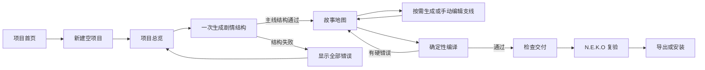

# N.E.K.O.-DramaticWriting Numeric v2 前端页面与交互开发文档

状态：当前前端实施基线与终点先行支线向导开发方向

本文只定义 N.E.K.O.-DramaticWriting Numeric v2 剧本生成器的作者前端。Story Package、服务端项目合同和
编译器的最终字段分别由后续数据结构与后端模块文档锁定；前端不得自行发明运行时字段。

上位文档：
[N.E.K.O.-DramaticWriting Numeric v2 剧本生成器开发文档](./2026-08-06-neko-theater-numeric-v2-generator-design.md)。

运行时边界：
`N.E.K.O/docs/design/neko-theater-architecture.md`（当前 Numeric v2.2 合同）。

## 1. 已锁定的页面决策

第一版采用桌面 Web 作者工具，保留两个页面：

1. 项目首页：新建、打开、导入和删除作者项目；
2. 作者工作台：在同一页面完成项目总览、故事地图和检查交付。

作者工作台固定提供三个长期工作区：

1. `项目总览`：集中编辑创作想法和基础需求；
2. `故事地图`：编辑背景、身份、隐藏数值、剧情节点、路线条件和结局；
3. `检查交付`：查看确定性问题、复验并导出或安装。

这三个工作区不是线性向导。前端使用常驻左侧导航，作者可随时回看全局设定、地图和交付状态。
后端仍保存 `setup/story/publish` 作为兼容恢复指针，但不得在界面上重新表现为编号步骤条、
“上一步/下一步”或底部阶段操作栏。

第一版同时锁定以下边界：

- 作者项目必须持久化，刷新和重新启动后可以继续编辑；
- 所有作者修改自动保存，不设置一个容易忘记的全局“保存”按钮；
- 模型只在作者明确点击时调用：首次主线一次，回接主线或已有结局的支线过程一次；新结局先生成
  结局草稿一次，作者确认后再生成过程一次；
- 不提供自动 Retry、自动 Repair、一键优化或 Planner；
- 不提供 JSON 编辑器；
- 不显示或编辑运行时推荐输入；
- 不生成和编辑固定 Choice；
- 不展示旧版本切换入口；
- 不在工作台运行猫娘 Actor 或模拟完整对话；
- 所有正式交付动作集中在“检查交付”，不散落在其它页面。

## 2. 页面路由

| 地址 | 页面 | 作用 |
| --- | --- | --- |
| `/` | 项目首页 | 查看项目、新建项目、导入 Numeric v2 包 |
| `/projects/new` | 新建项目 | 创建空项目后进入项目总览 |
| `/projects/{project_id}` | 作者工作台 | 根据项目保存的阶段恢复工作区 |
| `/projects/{project_id}?stage=setup` | 项目总览 | 创作想法和基础需求 |
| `/projects/{project_id}?stage=story` | 故事地图 | intro、隐藏 metric、节点、路线和结局 |
| `/projects/{project_id}?stage=publish` | 检查交付 | 编译、复验、导出和安装 |

`stage` 只决定当前展示区域，不拆成三份项目状态。浏览器前进、后退和刷新必须恢复当前阶段。
支线草稿生成后可以附加 `branch_draft={draft_id}` 作为纯视图恢复指针；刷新时通过草稿 API 恢复宽
面板，关闭或应用后移除。该参数不进入作者项目和 Story Package，也不能绕过服务端 revision 检查。
模型设置使用全局弹窗，不单独增加页面。

## 3. 主流程



导入合法 Numeric v2 Story Package 时直接创建作者项目，并进入“故事地图”。导入失败只显示
确定性问题，不创建半项目。

## 4. 全局页面框架

作者工作台使用三个稳定区域：

| 区域 | 固定内容 | 说明 |
| --- | --- | --- |
| 顶栏 | 返回项目、项目标题、保存状态、当前工作区主动作、模型设置 | 项目总览显示生成；故事地图显示检查交付 |
| 常驻左侧栏 | 项目总览、故事地图、检查交付及当前上下文摘要 | 不使用编号和步骤箭头 |
| 主工作区 | 当前工作区的主要内容 | 唯一可滚动主区域 |

故事地图额外使用右侧属性栏。右侧栏只编辑当前选择对象，不承担全局导航。地图内部不再放第二套
左侧节点导航，避免形成四栏布局；剧情概览、数值规则、生成支线、手动添加和问题入口统一放在
地图工具栏。支线向导使用故事地图内的宽面板，不新建页面，也不通过连续弹窗收集信息。

### 4.1 顶栏

从左到右固定显示：

- 返回项目；
- 项目标题，可就地修改；
- 当前状态：`未生成`、`编辑中`、`存在问题`、`可发布`；
- 保存状态：`已保存`、`保存中`、`保存失败`；
- 模型设置。

顶栏不得显示内部 project ID、revision、schema 或 package hash。技术信息只在问题详情或发布
结果中按需显示。

### 4.2 工作区导航

常驻导航允许作者在三个工作区间切换，但有以下规则：

- 未生成剧情前，“故事地图”和“检查交付”不可进入；
- 剧情存在硬错误时仍可进入“检查交付”查看问题，但交付动作禁用；
- 修改基础设定不会自动重新调用模型；
- 修改 metric 后立即使旧编译结果过期；
- 重新生成剧情结构必须由作者明确确认。

### 4.3 自动保存

- 文本、选择器和排序变化在本地立即生效；
- 停止输入约 600 ms 后进入单项目串行保存队列；
- 离开输入框时立即排队保存；
- 图节点拖动结束后只保存最终位置；
- 保存失败时保留本地内容，顶栏显示“保存失败”和“重试”；
- 保存冲突时不得静默覆盖服务端版本，应保留本地草稿并提示重新载入或复制内容；
- 生成、编译、导出和安装前必须等待当前保存队列完成。

## 5. 项目首页

### 5.1 页面目标

项目首页只帮助作者开始或继续创作，不展示剧情图和运行时内容。

页面包含：

- 标题“我的剧本”；
- 主按钮“新建剧本”；
- 次按钮“导入 Numeric v2”；
- 项目卡片列表；
- 模型配置状态入口。

### 5.2 项目卡片

每张卡片显示：

- 剧本标题；
- 一句话创作需求，最多两行；
- 最近修改时间；
- 当前阶段；
- metric 数量、剧情节点数量、结局数量；
- 状态：未生成、编辑中、存在问题、可发布；
- “继续编辑”；
- 更多菜单中的“删除项目”。

卡片不显示完整背景、原始 JSON、模型 Prompt、Token 或 package hash。

### 5.3 空状态

没有项目时显示：

- 说明：“先写下故事和数值规则，再由生成模型构建剧情地图。”；
- 主按钮“新建第一个剧本”；
- 次入口“导入 Numeric v2”。

不使用示例项目自动写入用户目录。示例内容后续如果需要，只作为显式模板。

### 5.4 删除项目

删除前弹窗显示剧本标题，并明确说明只删除 N.E.K.O.-DramaticWriting 作者草稿，不删除已经安装到 N.E.K.O 的包。
第一版要求作者再次点击“删除作者项目”，不使用输入项目名的重型确认。

## 6. 新建项目

访问 `/projects/new` 后立即创建最小空项目，再跳转到该项目的“项目总览”。这样刷新、返回或
意外关闭时不会丢失已经输入的需求。

空项目只包含：

- 服务端分配的 project ID；
- 默认标题“未命名剧本”；
- 空的创作设定；
- 空 metric 列表；
- `setup` 当前阶段；
- 创建和更新时间；
- 内容 revision。

空项目不预生成节点、分支、结局或默认爱情数值。

## 7. 项目总览

### 7.1 页面结构

项目总览使用单栏创作区，只编辑故事设定。隐藏数值已经移动到故事地图，和实际分支路线在同一
上下文中配置。生成或重新生成剧情结构放在顶栏，按钮文案明确其
产物是故事地图草稿；页面不提供底部“下一步”按钮，也不放实时演绎预览。

### 7.2 故事设定

| 字段 | 控件 | 必填 | 规则 |
| --- | --- | --- | --- |
| 剧本标题 | 单行输入 | 是 | 1–160 字符 |
| 创作想法 | 多行输入 | 是 | 超过 30 个非空白字符后可生成主线与一个 Normal 结局 |
| 题材 | 可输入选择器 | 否 | 预设仅帮助填写，不限制题材 |
| 基调 | 可输入选择器 | 否 | 支持多个短标签 |
| 初始关系 | 多行短文本 | 否 | 生成后自动填写，作者可修改 |
| 内容禁区 | 可增删列表 | 否 | 每条是一项明确禁止内容 |
| 篇幅 | 单选卡片 | 是 | 放在创作想法上方；约束主线章节数量 |

页面不再提供独立“AI 扩写”按钮。顶栏“生成剧情结构”提交当前创作想法和目标篇幅，模型只生成
主线与一个 Normal 结局。服务端通过结构和主线数量检查后，将大纲整理成文本、回填初始关系和整体基调，
并确定性投影为故事地图草稿。失败时保留原内容和旧地图。

### 7.3 数值模块位置

项目总览不显示数值表单。数值不属于首次生成输入，也不发送给主线生成模型。进入故事地图后，
作者通过工具栏“数值规则”打开宽属性抽屉；下述数值编辑能力全部位于该抽屉中。

### 7.4 本剧数值总览

数值区顶部显示：

- 已启用数量；
- 预设 metric 选择按钮；
- “添加自定义数值”；
- 语义重叠软提示；
- 当前未完成配置数量。

预设区使用可多选短卡片，不使用一长列复选框。卡片只显示名称和一句含义；选中后在下方创建
完整 metric 卡片。预设只是可编辑模板，不锁定含义。

第一版预设：

- 好感度；
- 信任度；
- 厌恶度；
- 戒备度；
- 亲密度；
- 压力值；
- 恐惧度；
- 勇气值；
- 怀疑度；
- 线索进度。

### 7.5 metric 卡片

每张已启用 metric 卡片的折叠摘要显示：

- 名称；
- 初始值和范围；
- 增加依据数量；
- 减少依据数量；
- 完整、缺少配置或存在提示。

展开后按以下顺序编辑：

1. 名称；
2. 含义；
3. 增加依据；
4. 减少依据；
5. 高级数值设置。

Numeric v2 的所有 metric 固定对玩家隐藏。前端不提供可见性选项，Story Package 中仍保留
`visibility` 合同字段，但只能写入 `hidden`。

增加和减少依据使用“每条一行”的可增删列表，不使用一个以逗号分隔的大文本框。每条输入都有
明确方向标题，避免作者把正负依据写反。

### 7.6 自定义数值

点击“添加自定义数值”后直接插入一张空 metric 卡片并聚焦名称，不使用额外弹窗。卡片在以下
内容完整前保持“未完成”：

- 名称；
- 含义；
- 至少一条增加依据；
- 至少一条减少依据；
- 合法范围和初始值；

metric ID 由服务端根据首次保存时的名称分配并保持稳定。作者后续改名不会改变 ID，前端也
不显示 ID 编辑框。

### 7.7 高级数值设置

默认折叠，展开后包含：

- 最小值；
- 最大值；
- 初始值；
- 单回合最大增加；
- 单回合最大减少；
- 区间表现 bands。

bands 使用行式编辑器，每行包含起始值、结束值和表现标签。作者可以增加、删除和排序区间。
前端实时提示重叠、断档和越界，但不替作者静默修改边界。

表现标签同时是“生成支线”向导的触发语义来源。区间结构合法只代表可以手动编译；至少有两个
能表达剧情差异的标签，才代表可以使用引导式支线创作。“低位/中位/高位”“当前状态”等旧占位
标签应显示“需要完善后才能生成支线”，并提供示例，但不得由前端或模型静默改写。

### 7.8 删除 metric

- 如果没有 route gate 引用，二次确认后删除；
- 如果存在 route gate 引用，阻止删除并列出引用路线；
- 不自动删除路线条件，也不自动替换成其它 metric。

### 7.9 生成前检查

点击“生成剧情结构”时，前端先检查：

- 必填故事设定；
- 创作想法去除空白后超过 30 个字符；
- 合法目标篇幅。

有错误时页面滚动到第一处错误，并在常驻导航和当前工作区摘要中显示数量。不发送模型请求。

### 7.10 生成状态

生成期间：

- 主按钮变为“正在生成剧情结构”；
- 故事设定保持可阅读但暂时禁用编辑；
- 显示当前只有“生成主线与 Normal 结局”一个模型步骤；
- 不显示伪造进度百分比；
- 不显示 Planner、评分、润色或 Repair 文案；
- 关闭页面不会触发第二次请求，重新打开项目读取服务端任务结果。

生成成功后采用确定性投影结果作为项目剧情草稿，并进入“故事地图”。主线和 Normal 结局之间的
单出口连接线条件为空，地图显示“顺序推进”，并允许直接编译。作者创建多出口分支后，地图才将
空条件标为“待设置分支条件”。

模型 JSON 或确定性编译失败时：

- 不采用半成品为正式剧情草稿；
- 完整保留作者的故事设定和 metric；
- 按字段路径显示全部合同错误；
- 提供“返回修改设定”；
- 作者可以明确再次点击生成，但系统不自动重试；
- 不提供“一键修复”。

### 7.11 重新生成

已经有剧情结构时，按钮文案改为“重新生成剧情结构”。确认弹窗必须说明：

- 将替换当前 intro、节点、路线和结局；
- 保留故事设定和 metric 配置；
- 不影响已经导出或安装的包；
- 操作成功前继续保留当前草稿；
- 生成失败时不覆盖当前草稿。

## 8. 故事地图

### 8.1 页面结构

故事地图在全局左侧栏之外使用两栏布局：

| 区域 | 宽度职责 | 内容 |
| --- | --- | --- |
| 中央画布 | 主要空间 | 正式剧情图和地图工具栏 |
| 右侧属性栏 | 默认固定宽度，数值抽屉加宽 | 当前概览、数值、节点、路线或结局编辑器 |

故事概要和隐藏数值摘要放在全局左侧栏。剧情概览、数值规则、生成支线、手动添加和问题入口放在地图
工具栏，不再增加第二套剧情大纲侧栏。右侧属性栏可以折叠，中央图支持适应窗口和自动排布。

### 8.2 剧情图展示

图中只存在三种节点：

- 开场；
- 幕；
- 结局。

分支通过多条 route gate 连线表达，不增加“分支”空节点。连线默认摘要显示：

- 人类可读的触发语义；
- 目标节点或结局；
- 硬错误或软警告标记。

all/any、metric ID、比较符、原始阈值和 priority 只在路线编辑器的“高级条件”中展示，不要求新作者
从剧情图直接理解这些字段。

图中明确不显示：

- 固定 Choice；
- 运行时推荐输入；
- 逐轮对白；
- Session 数值；
- Ledger；
- 模型内部推理。

### 8.3 地图工具栏

地图工具栏提供：

- “剧情概览”；
- “数值规则”；
- “问题”入口和数量；
- “生成支线”；
- “手动添加”。

未选中节点时，“生成支线”不可用并提示“先选择支线从哪里开始”。选中符合第 8.8 节条件的来源
节点后，它成为故事地图的首要支线动作。点击“手动添加”再选择“幕节点”或“结局节点”；类型创建后不可由 AI
或普通字段编辑静默转换。

点击图节点和点击路线使用同一选择状态。问题入口进入检查交付；问题项点击后应回到对应节点或
路线，并聚焦右侧具体字段。

### 8.4 剧情概览编辑器

未选择图元素或点击“剧情概览”时，右侧显示：

- 背景介绍；
- 玩家身份；
- 猫娘剧本身份；
- 当前猫娘 role overlay；
- metric 摘要，链接到故事地图数值抽屉；
- 主线顺序摘要；导入项目无法唯一识别时显示“确认主线顺序”；
- 节点、路线和结局数量。

characters 第一版放在概览的“其他角色”折叠区。每个其他角色只编辑名称、故事职责和公开描述，
不提供人格运行时配置。

“管理主线顺序”属于高级作者工具，只排列现有非结局节点并检查图中顺序，不调用模型。保存后写入
N.E.K.O.-DramaticWriting 项目的 `authoring.mainline_node_ids`，不改变 node ID、不自动重接路线，也不进入 Story Package。

### 8.5 剧情节点编辑器

选择开场或剧情节点时，右侧按以下顺序显示：

| 字段 | 控件 | 说明 |
| --- | --- | --- |
| 节点标题 | 单行输入 | 作者用于识别，不直接充当对白 |
| 节点类型 | 只读标签 | start 或 scene |
| 剧情摘要 | 多行输入 | 当前正式剧情发生什么 |
| 必须发生 | 可增删列表 | Actor 必须交付的作者事件 |
| 不得发生 | 可增删列表 | 当前阶段不能提前发生的内容 |
| 猫娘当前处境 | 多行输入 | 当前目标、顾虑和关系位置 |
| 过渡目标 | 多行输入 | 当前自由演绎应自然围绕什么发展 |

节点不保存开场台词、固定旁白、玩家台词或下一轮建议。

自定义幕节点填写标题和剧情摘要后可以点击“AI 完善幕节点”。请求必须带上幕节点类型、上文、
进入路线、数值规则和作者预填内容；模型只能回填必须发生、不得发生、猫娘处境和过渡目标。

### 8.6 结局编辑器

结局节点在同一属性栏编辑：

- 结局标题；
- 结局摘要；
- 必须发生的结局事件；
- 不得逆转的作者事实；
- 猫娘在结局中的处境；
- 收束语气；
- 进入该结局的路线列表。

结局节点不能创建出边。删除结局前必须先处理所有指向它的 route gate。

结局节点同样提供“AI 完善结局节点”，并把结局节点类型明确发送给模型。模型的过渡目标必须收束
当前路线，不能创建后续分支。

### 8.7 路线编辑器

点击连线后，右侧默认显示：

1. 来源节点，只读；
2. 目标节点选择；
3. 人类可读的触发语义；
4. 触发原因；
5. 必须交付；
6. 必须保留；
7. 过渡语气；
8. “高级条件”折叠区。

“高级条件”展开后才显示：

- 条件模式：全部满足 `all` 或任一满足 `any`；
- metric、比较符和整数阈值；
- priority。

每条条件行固定包含：

- metric 选择；
- 比较符：`>=`、`>`、`<=`、`<`、`==`、`!=`；
- 整数阈值；
- 删除条件。

第一版不支持嵌套 all/any、公式编辑器、时间条件或任意脚本。

支线向导创建的路线默认收起高级条件；作者手动新建路线时可默认展开。作者修改正式条件后，这条
路线进入普通手动编辑合同，不再承诺保持向导生成时的人类可读 band 映射。

来源节点只有一条出路时，`conditions` 可以是 `{ "all": [] }`，语义是无条件顺序推进。同一来源
节点存在两条或以上出路时，每条路线至少需要一个 metric 条件，否则编译失败。

路线顶部实时显示人类可读摘要，例如：

```text
当她已经愿意把重要秘密托付给玩家时，进入“未寄出的信”。
```

对应原始表达式只在高级区显示，例如“信任度 ≥ 70；优先级 20”。

### 8.8 支线向导入口与资格

选中非结局节点后，作者可以点击工具栏或节点快捷动作“生成支线”。首版只有同时满足以下条件时
才能进入：

- 来源节点恰好有一个出口；
- 唯一出口是无条件顺序推进；
- 出口目标存在；
- 项目至少有一个结构合法、包含两个以上有效语义 bands 的 metric；
- 当前没有保存冲突，且项目不是生成、应用或编译中的只读状态。

已有多出口、已有条件的单出口、结局节点和无出口节点不由向导自动改写。按钮保持可见但禁用，
直接说明原因，并提供“查看现有路线”或“使用手动编辑”，不能只显示技术错误码。

向导在故事地图内打开宽面板，地图仍保留在背景中用于确认来源和终点。打开向导、填写内容、生成
草稿都不创建正式节点，也不改变项目 revision。

### 8.9 先选终点，再描述过程

向导第一个问题固定为“这条支线最后去哪？”，一次提供三类互斥选项：

1. `回到主线`：继续询问具体回接幕；
2. `通往已有结局`：以结局卡片展示标题和摘要；
3. `产生新结局`：先填写希望结局呈现的结果、代价或情绪。

选择“回到主线”后，第二个问题固定为“回到哪一幕？”。候选按主线顺序纵向排列：

- 原顺序出口的下一幕置顶，标记“推荐 · 紧接当前剧情”并默认选中；
- 后续主线幕显示标题、两行摘要、“将绕过 N 幕”和“需处理 N 项关键事实”；
- 根据绕过幕和连续性事项只显示服务端 `allowed_lengths` 中的 1/2/3 幕；目标变化后若原长度不再合法，确定性切换到最接近的合法默认值；
- 展开候选可查看具体绕过的幕和关键事实，但默认不显示内部 node ID；
- 会形成环、主线顺序已失效或必要上下文超过模型安全预算的候选保持可见但禁用，并说明原因；
- 地图同步高亮来源、所选回接幕和中间被绕过的主线段。

主线顺序来自 N.E.K.O.-DramaticWriting 作者项目元数据，不按 `mainline_XX` 前缀或画布左右位置猜测。导入项目没有可靠
主线顺序时，“回到主线”显示“先确认主线顺序”，并打开不调用模型的确认向导。该向导从开场沿现有
唯一路线自动前进，只在多出口处询问“哪一幕仍属于主线”；保存只写 `authoring.mainline_node_ids`，
不重接路线、不改变 Story Package。来源节点本身不在确认后的主线顺序中时，首版仍禁用该选项并说明
可使用已有结局、新结局或高级路线编辑。

后续问题使用业务语言，不要求作者理解 node、route 或 threshold：

- “这条支线想发生什么？”：自然语言多行输入，可写冲突、误会、调查、关系变化或必须保留的感觉；
- “玩家怎样会走上这条路？”：选择一个人类可读触发条件，或选择“让生成模型从这些条件中推荐”；
- “这条支线多长？”：短支线 1 幕、标准支线 2 幕、长支线 3 幕，默认标准。

触发条件卡片只展示 metric 名称、band 的剧情含义和简短行为依据，例如“信任度：已经愿意托付
重要秘密”。不在这一步显示 metric ID、原始数值、比较符或 priority。作者需要精确控制时可进入
“高级路线编辑”，但离开向导前必须明确确认放弃当前未应用草稿。

若没有可用候选，面板不发起模型请求，并给出两个明确动作：

- “完善数值规则”：打开对应 metric 的 bands 编辑位置；
- “选择推荐数值”：打开预设选择，由作者确认后加入项目。

不得自动新增 metric，也不得用一个无条件出口作为第二条路线。

选择较后回接幕时，面板在生成按钮前再次摘要“这条支线将替代《A》《B》两幕，并在《C》重新汇入”。
被绕过主线幕及其关键事实进入本次必要上下文；超出 16K 输入硬上限的目标不能靠截断强行生成。

### 8.10 新结局的两段式生成

选择“产生新结局”后，按钮先显示“生成结局草稿”。一次模型调用完成后，在同一面板展示可直接
编辑的：

- 结局标题和摘要；
- 必须发生的结局事件；
- 不得逆转的作者事实；
- 猫娘处境；
- 收束语气。

此时不生成支线过程，也不在地图创建结局节点。作者确认内容后，第二个按钮才显示“根据结局生成
过程”。第二次模型调用必须使用作者当前编辑后的结局。修改字段不自动调用模型；“重新生成结局”
和“重新生成过程”都是作者明确触发的单次请求。

### 8.11 支线生成状态

回到主线或通往已有结局时，“生成支线草稿”只调用模型一次。生成期间：

- 明确显示正在生成的是“通往《终点名称》的 2 幕过程”；
- 不显示伪造百分比、思维过程、Planner、评分或 Repair；
- 防止重复点击，同一请求只能存在一个活动任务；
- 作者可以离开工作区，返回后读取服务端草稿状态；
- 失败保留终点、方向、长度、触发选择和已确认结局，但不改变正式地图。

上下文或模型预算不足时，显示“当前内容超过该模型可安全生成的范围”，并定位建议缩短的作者字段。
前端不得自行截断文本后重试，也不得自动切换模型。

### 8.12 支线草稿预览与应用

过程生成成功后进入统一预览。正式地图在作者应用前保持原样，宽面板按顺序显示：

1. 来源节点与最终终点；
2. 回到主线模式下的被绕过主线幕；
3. 人类可读的支线触发语义和选择理由；
4. 1—3 张幕节点卡片，默认突出标题、摘要和过渡目标；
5. 已被支线承接的连续性原文；
6. 新结局卡片，仅新结局模式显示；
7. “高级条件”，折叠展示正式条件、补集和 priority。

首版只允许“已在支线承接”，不提供“有意改写”。每项连续性事实都由服务端确定性注入相应幕或
过渡合同；任何遗漏、重复或非法位置都会拒绝草稿。作者需要改写既定事实时退出向导，使用高级手动
编辑并同步检查下游节点。

作者可以返回修改方向并明确重新生成。新结局需要修改时必须返回结局确认区；一旦修改，当前过程
草稿立即失效，作者需再次明确点击“根据结局生成过程”。首版不在预览中逐字段重写模型生成的幕
节点，应用后再使用普通节点编辑器修改，避免同时维护两套自动保存状态。

主按钮“应用支线草稿”只有在草稿未过期且确定性检查无硬错误时可用。点击后锁定重复提交，服务端
以一个 revision 原子创建全部节点、路线、过渡合同和可选结局。成功后关闭向导、刷新地图并选择
第一个新幕节点；失败时继续展示原正式地图和草稿，不出现空节点、孤立结局或半条路线。

如果来源、原出口、终点、相关 metric 或上游事实在生成后已变化，预览切换为“草稿已过期”，禁用
应用并要求作者重新生成。重复响应、重复点击和并发应用必须显示同一个最终结果，不能重复创建结构。

### 8.13 手动添加节点和路线

- “手动添加”先选择类型；幕节点创建内容为空的新 scene，结局节点创建 terminal node 与 ending 的成对草稿；
- 可以从幕节点右侧连接点直接拖到另一个节点，也可以在属性栏选择目标节点；
- 第一个出口可以保持空条件；创建第二个出口前需要至少一个 metric，创建后必须为所有出口补齐条件；
- 节点和 route gate ID 均由服务端分配；
- 每条可达支线必须最终连接到结局节点。非结局幕节点无出边，或进入不能到达结局的循环，均不能编译。

手动模式继续提供“AI 完善幕节点/结局节点”，但它只完善当前节点的四项演绎约束，不生成支线、
不改变节点类型或路线，也不代替终点先行向导。

### 8.14 删除和结构修改

- 删除节点前显示入边、出边和受影响结局；
- 有连接时默认阻止删除，作者先明确删除相关路线；
- 修改路线目标必须重新编译；
- 修改 metric 范围后，所有超出新范围的路线立即标错；
- 不自动重接路线，不自动合并节点，不自动选择替代结局。

### 8.15 问题展示

硬错误使用“问题”标记，软质量问题使用“提示”标记。两者不能只依赖颜色区分。

错误必须包含：

- 作者可理解的中文说明；
- 对象名称；
- 字段位置；
- 跳转按钮；
- 稳定 issue code，默认折叠在详情中。

错误区不出现“AI 修复”按钮。

## 9. 检查交付

### 9.1 页面结构

按顺序展示三个区块：

1. 编译状态；
2. 问题与提示；
3. 复验和交付。

### 9.2 编译状态

顶部摘要显示：

- metric、节点、路线和结局数量；
- 最近编译时间；
- 当前内容是否在编译后发生变化；
- 硬错误数量；
- 软提示数量；
- package hash，仅在编译成功后显示在详情中。

主按钮为“检查剧本”。它只运行确定性编译，不调用模型。

作者修改任何正式内容后，原编译状态立即变为“需要重新检查”，复验、下载和安装按钮全部禁用。

### 9.3 问题与提示

问题按以下分组：

- 数值配置；
- 背景与身份；
- 剧情节点；
- 路线条件；
- 结局；
- 可达性；
- N.E.K.O 复验。

点击问题返回“项目总览”或“故事地图”，并定位具体对象。软提示不阻止导出，除非 N.E.K.O
复验将其定义为硬错误。

### 9.4 N.E.K.O 复验

确定性编译成功后启用“使用 N.E.K.O 复验”。复验结果显示：

- 通过或失败；
- N.E.K.O 编译器版本或合同版本；
- 被验证的 package hash；
- 全部问题；
- 复验时间。

项目内容变化后旧复验立即失效。前端不能只凭曾经通过的布尔值继续开放交付按钮。

### 9.5 导出

复验通过后启用“下载 Story Package”。下载必须使用复验过的 canonical bytes，不由浏览器
重新序列化当前对象。

下载完成不改变项目状态，不自动安装。

### 9.6 安装

安装是与下载并列的独立动作。点击后显示：

- 目标 N.E.K.O 数据目录；
- story ID；
- package hash；
- 是否存在同 ID 包；
- “安装到 N.E.K.O”。

同 ID 已存在时默认阻止覆盖。第一版如果支持覆盖，必须使用独立确认弹窗并显示备份位置；不能
把覆盖作为普通复选框默认勾选。

安装成功后显示目标路径和时间，不自动启动 N.E.K.O，也不创建 Session。

## 10. 全局弹窗

第一版只保留以下弹窗：

- 模型设置；
- 导入 Numeric v2；
- 删除作者项目；
- 重新生成剧情结构；
- 删除被引用对象的阻断说明；
- 覆盖安装确认；
- 保存冲突。

不得为普通字段编辑反复打开弹窗。metric、节点、路线和结局都在当前页面直接编辑。
支线向导是故事地图内的宽面板，不加入全局弹窗列表；新结局确认和草稿预览也在该面板内完成。

### 10.1 模型设置

模型设置包含：

- 服务商；
- 模型名称；
- API 地址；
- API Key；
- 当前是否已配置 Key；
- 保存并测试连接。

读取设置时不回显 API Key。测试连接是作者明确触发的独立短请求，不生成剧本。
保存后，服务商、模型、API 地址和 API Key 写入仓库外的用户级本机配置；包含密钥的配置文件权限
限制为当前用户读写。服务重启后自动恢复，API 和前端始终不回显 Key 明文。

### 10.2 导入

导入弹窗只接受 JSON 文件，流程为：

```text
选择文件 -> 本地大小与 JSON 检查 -> 服务端 Numeric v2 编译
-> 成功后创建作者项目 -> 进入故事地图
```

不能导入其它 schema 后在前端猜测转换。

## 11. 页面状态模型

### 11.1 项目派生状态

前端显示状态必须由项目内容和最新检查结果派生，不允许多个布尔值互相矛盾。

| 状态 | 判定 | 允许动作 |
| --- | --- | --- |
| `setup` | 尚无已采用剧情草稿 | 编辑设定、生成 |
| `generating` | 当前有显式主线生成任务 | 查看任务、等待或离开 |
| `editing` | 有剧情草稿但未通过当前 revision 编译 | 编辑、检查 |
| `invalid` | 当前 revision 编译失败 | 编辑、查看问题、再次检查 |
| `compiled` | 当前 revision 编译成功 | 查看报告、N.E.K.O 复验 |
| `verified` | 当前 hash 已通过 N.E.K.O 复验 | 下载、安装 |

任何正式内容变化都使 `compiled` 或 `verified` 回到 `editing`。

### 11.2 前端临时状态

前端只额外维护：

- 当前阶段；
- 当前选中的 node、route 或 ending；
- 属性栏是否折叠；
- 图缩放和画布位置；
- 尚未发往服务端的输入草稿；
- 保存队列；
- 当前支线向导和服务端草稿；
- 当前弹窗。

支线草稿、弹窗和临时错误焦点都不写入 Story Package。支线草稿可以由服务端暂存以支持刷新恢复，
但只有原子应用成功后才进入正式项目 revision。

## 12. 前端视图数据结构

以下结构只服务页面状态，不等同于 Story Package 合同。

```ts
type WorkspaceStage = "setup" | "story" | "publish";

type ProjectStatus =
  | "setup"
  | "generating"
  | "editing"
  | "invalid"
  | "compiled"
  | "verified";

type WorkspaceSelection =
  | { kind: "overview" }
  | { kind: "node"; id: string }
  | { kind: "route"; id: string }
  | { kind: "ending"; id: string };

type BranchEndpoint =
  | { kind: "rejoin"; targetNodeId: string }
  | { kind: "existing-ending"; endingId: string }
  | { kind: "new-ending" };

type BranchLength = "short" | "standard" | "long";

type BranchDraftStatus =
  | "configuring"
  | "generating-ending"
  | "ending-review"
  | "generating-path"
  | "preview"
  | "applying"
  | "applied"
  | "stale"
  | "failed";

interface BranchWizardViewState {
  sourceNodeId: string;
  endpoint: BranchEndpoint | null;
  direction: string;
  length: BranchLength;
  conditionKey: string | null;
  confirmedContinuityKeys: string[];
  draftId: string | null;
  baseRevision: string;
  status: BranchDraftStatus;
  errorCode?: string;
}

interface WorkspaceViewState {
  stage: WorkspaceStage;
  selection: WorkspaceSelection;
  inspectorCollapsed: boolean;
  graphViewport: { x: number; y: number; zoom: number };
  branchWizard: BranchWizardViewState | null;
  activeDialog: null | {
    kind: "model-settings" | "import" | "delete-project" |
      "regenerate" | "overwrite-install" | "save-conflict";
  };
}

interface MetricFormDraft {
  id: string;
  preset: string | null;
  name: string;
  description: string;
  min: number;
  max: number;
  initial: number;
  increaseLimit: number;
  decreaseLimit: number;
  increaseCriteria: string[];
  decreaseCriteria: string[];
  visibility: "hidden";
  bands: Array<{ min: number; max: number; label: string }>;
}

interface IssueViewModel {
  code: string;
  severity: "error" | "warning";
  group: "metric" | "intro" | "node" | "route" |
    "ending" | "reachability" | "neko";
  message: string;
  path: string;
  target: WorkspaceSelection;
  field?: string;
}
```

服务端 DTO 和 Story Package 使用 snake_case；前端是否转换为 camelCase 只能在单一 API 适配层
完成，组件中不得混用两种命名。

## 13. 前端模块功能

建议模块边界：

```text
frontend/theater/index.html
frontend/theater/src/main.js                # 应用启动和顶层错误边界
frontend/theater/src/router.js              # 两个页面和 stage URL 同步
frontend/theater/src/api.js                 # 唯一请求与 DTO 转换边界
frontend/theater/src/state.js               # 项目快照、视图状态、保存队列
frontend/theater/src/copy.js                # 用户可见文案
frontend/theater/src/project-home.js        # 项目首页和空状态
frontend/theater/src/workspace-shell.js     # 顶栏、常驻工作区导航和上下文摘要
frontend/theater/src/setup-form.js          # 故事设定
frontend/theater/src/metric-editor.js       # preset、自定义 metric、criteria、bands
frontend/theater/src/story-graph.js         # 正式剧情图和选择同步
frontend/theater/src/story-inspector.js     # 概览、节点、路线、结局编辑器
frontend/theater/src/branch-wizard.js       # 终点先行配置、结局确认和草稿预览
frontend/theater/src/mainline-order.js       # 旧项目的确定性主线顺序确认
frontend/theater/src/publish-panel.js       # 编译、问题、复验和交付
frontend/theater/src/dialogs.js             # 全局确认和设置弹窗
frontend/theater/src/styles.css             # 页面布局和状态样式
```

模块职责规则：

- `api.js` 不持有页面状态；
- `state.js` 不拼接用户文案；
- `story-graph.js` 不修改 Story Package，只发出明确编辑意图；
- `story-inspector.js` 不直接调用模型；
- `branch-wizard.js` 不构造正式阈值、priority 或 route，只消费服务端候选和草稿；
- `publish-panel.js` 不重新序列化 canonical bytes；
- `copy.js` 不保存 schema 字段名或编译逻辑；
- 组件不各自实现保存重试，统一进入 `state.js` 保存队列。

## 14. 前端需要的服务端能力

页面设计要求后端最终提供以下能力；具体请求和响应由后端数据结构文档锁定：

```text
GET    /api/theater/numeric-v2/projects
POST   /api/theater/numeric-v2/projects
GET    /api/theater/numeric-v2/projects/{project_id}
PATCH  /api/theater/numeric-v2/projects/{project_id}
DELETE /api/theater/numeric-v2/projects/{project_id}

POST /api/theater/numeric-v2/projects/import
POST /api/theater/numeric-v2/projects/{project_id}/generate
GET  /api/theater/numeric-v2/projects/{project_id}/nodes/{node_id}/branch-options
PUT  /api/theater/numeric-v2/projects/{project_id}/mainline-order
POST /api/theater/numeric-v2/projects/{project_id}/branch-ending-drafts
POST /api/theater/numeric-v2/projects/{project_id}/branch-drafts
GET  /api/theater/numeric-v2/projects/{project_id}/branch-drafts/{draft_id}
POST /api/theater/numeric-v2/projects/{project_id}/branch-drafts/{draft_id}/apply
POST /api/theater/numeric-v2/projects/{project_id}/compile
POST /api/theater/numeric-v2/projects/{project_id}/validate-neko
GET  /api/theater/numeric-v2/projects/{project_id}/export
POST /api/theater/numeric-v2/projects/{project_id}/install
```

所有项目写请求必须携带 base revision。生成、编译和复验结果必须绑定明确 revision 或 package
hash，前端不得把过期结果当作当前许可。

`branch-options` 只读取确定性资格、可读条件候选、已有结局和按主线顺序排列的回接幕，不调用模型。
每个回接幕包含被绕过节点、连续性事项、预计 tokens 和禁用原因。支线草稿响应必须包含状态、
`base_revision` 和上下文指纹。前端不自行推导候选条件、主线顺序、补集或是否
过期。旧项目通过 `mainline-order` 保存作者确认的顺序；新结局先调用 `branch-ending-drafts`，作者
编辑后的结局随第二次 `branch-drafts` 请求提交。`apply` 使用草稿 ID 和 base revision，成功后只能
采用服务端返回的新项目 revision。

## 15. 小屏和可访问性

第一版以宽度至少 1180 px 的桌面窗口为主。低于 900 px 时不强行压缩成不可用的三栏编辑器，
而是显示“请扩大窗口继续编辑”，但项目首页仍应可用。

可访问性最低要求：

- 所有输入有可见 label；
- 错误不只使用红色；
- 当前选择不只依赖背景色；
- 工作区导航、项目卡片和弹窗支持键盘操作；
- 弹窗打开后正确管理焦点，关闭后回到触发按钮；
- 图中的节点、路线和工具栏按钮均可通过键盘聚焦和触发；
- 支线终点、触发条件和长度使用可键盘操作的单选组，步骤变化后把焦点移到新标题；
- 保存、生成、检查和安装状态通过 `aria-live` 提示；
- 动效遵守 reduced motion。

## 16. 文案与国际化

第一版先完成中文界面，但所有用户可见文案集中在 `copy.js`，不得散落在组件和错误判断中。
编译器返回稳定 issue code，前端映射为作者可理解的文案；未知 code 使用通用错误并保留技术
详情，不能直接把异常堆栈展示给作者。

关键按钮文案固定为：

- 新建剧本；
- 生成剧情结构；
- 重新生成剧情结构；
- 生成支线；
- 生成结局草稿；
- 根据结局生成过程；
- 生成支线草稿；
- 应用支线草稿；
- 高级路线编辑；
- 管理主线顺序；
- 检查剧本；
- 使用 N.E.K.O 复验；
- 下载 Story Package；
- 安装到 N.E.K.O。

不使用“一键修复”“智能优化”“自动完善”“继续规划”等会暗示额外模型链路的文案。

## 17. 前端测试要求

最低测试矩阵：

- 项目首页空状态、项目列表、继续编辑和删除确认；
- 新建项目后刷新仍能恢复项目总览；
- preset metric 和自定义 metric；
- criteria 增删、范围、限幅、固定隐藏和 bands；
- 生成前本地校验不会调用 API；
- 生成中重复点击只产生一个请求；
- 生成失败保留设定，且不采用半成品；
- 重新生成确认和失败不覆盖旧剧情；
- 图节点和路线选择与右侧属性栏一致；
- 概览、节点、路线和结局属性栏；
- 单出口无条件节点启用“生成支线”，多出口、有条件出口、结局和无出口节点给出明确阻断原因；
- 先选终点，再填写支线方向、触发语义和 1/2/3 幕长度；
- 选择回到主线后必须再选择具体幕，原下一幕默认推荐；
- 后续回接候选按主线顺序显示绕过幕、连续性事项和预算阻断原因；
- 导入项目主线无歧义时确定性建立，有歧义时要求作者确认顺序且不依赖 ID 前缀；
- 已有结局只显示合法结局，新结局先确认结局草稿再生成过程；
- 回接主线和已有结局各只发送一次过程请求；
- 新结局编辑不调用模型，两个生成按钮各只发送一次请求；
- 无 metric、非法或占位 bands 时不调用模型，并定位数值规则；
- 默认条件卡片和路线摘要不显示 ID、阈值或 priority，高级区可以查看；
- 生成失败保留向导输入且正式地图不变；
- 草稿预览的节点顺序、终点、被绕过幕、连续性承接、互补语义和问题完整；
- 模型遗漏、重复处理或尝试“有意改写”连续性事项时不能形成可应用草稿；
- 应用成功一次更新地图，重复、并发、过期或失败应用不创建半结构；
- 刷新后能通过服务端草稿状态恢复生成结果；
- route condition builder 的 all、any、比较符和 priority；
- 删除被引用 metric、节点和结局时阻断；
- 问题跳转到正确阶段、对象和字段；
- 自动保存串行化、失败重试和 revision 冲突；
- 内容变化使编译和复验结果过期；
- 下载使用服务端 bytes，不使用浏览器重序列化；
- 安装覆盖需要独立确认；
- 不出现 Choice、推荐输入、Planner 或 Repair 编辑入口；
- 不出现数值路径模拟器或 metric 可见性控件；
- 900 px 以下显示明确窗口提示；
- 键盘和焦点基本回归。

## 18. 页面验收标准

作者体验：

- 新作者能从项目首页明确找到“新建剧本”；
- 作者不懂 JSON 也能配置 metric、剧情节点、分支和结局；
- 作者能从一个主线节点先选择支线终点，再生成通往该终点的 1—3 幕过程；
- 选择回到主线时，作者能明确选择具体回接幕，并在生成前看到会绕过什么；
- 选择较后回接幕时，每项关键事实都有可见的承接说明；
- 新结局会先单独展示并允许编辑，不会连同过程一次性写入地图；
- 作者不需要手算数值阈值，但能看懂支线在什么剧情状态下触发；
- 没有适合的数值规则时，页面明确引导完善或确认添加预设，不让模型静默发明；
- 作者能看懂每条路线何时触发；
- 所有硬问题都能从问题列表跳到可编辑位置；
- 模型失败不会清空作者输入或覆盖已有剧情；
- 作者能明确区分“生成剧情”和“确定性检查”；
- 发布前能看见 N.E.K.O 复验是否对应当前内容；
- 页面不会诱导作者预写玩家每轮输入。

架构边界：

- 页面中没有固定 Choice 编辑器；
- 页面中没有运行时推荐输入编辑器；
- 页面中没有 Session 或 Ledger 编辑器；
- 页面中没有自动 Repair 或 Planner 操作；
- 支线模型调用次数由明确按钮边界约束，不存在隐藏 Retry；
- 正式条件、路线补集、priority、ID 和原子应用都来自服务端确定性结果；
- 支线草稿与正式 Story Package 分离，并受 revision、指纹和幂等保护；
- 项目 revision、编译 hash 和复验 hash 不会串线；
- 用户数据、视图临时状态和 canonical package 三者边界明确。

## 19. 本轮不锁定的视觉项

本轮锁定信息架构、页面行为和组件职责，不锁定：

- 品牌颜色；
- 字体；
- 圆角和阴影；
- 图节点的最终视觉风格；
- 图标库；
- 动效细节。

这些视觉项必须在开始前端实现前基于实际 N.E.K.O.-DramaticWriting/N.E.K.O 品牌素材单独确认，不能由代码临时
发明一套样式。
